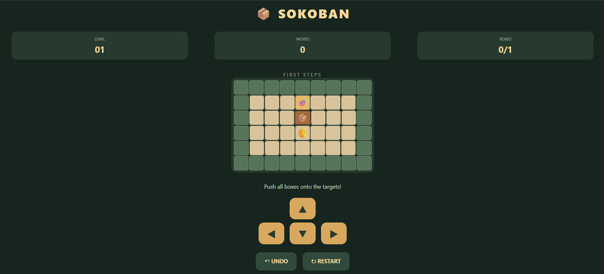

# SokobanQuest

SokobanQuest is a mobile puzzle game built with React Native, Expo, and TypeScript. Push every box onto a target to solve a level. Boxes can be pushed but not pulled, so plan each move carefully.

## Gameplay

- Move the player with the on-screen arrow buttons.
- Push boxes onto all targets to complete the current level.
- Track your level, move count, and boxes already on targets in the status cards.
- Undo the previous move or restart the current level at any time.
- Completing a puzzle advances the campaign. Finish the last level to replay the campaign.

## Run with Expo Go

Requirements: Node.js and the Expo Go app on an Android or iOS device.

1. Install dependencies:
   ```sh
   npm install
   ```
2. Start the development server:
   ```sh
   npm start
   ```
3. Open Expo Go and scan the QR code. Keep the phone and development computer on the same Wi-Fi network.

Run the TypeScript check with:

```sh
npm run typecheck
```

## Architecture

- `index.tsx` registers the root component with Expo.
- `App.tsx` renders the game and manages the active level, player and box positions, move history, win detection, and campaign progression.
- `App.styles.ts` holds the React Native `StyleSheet` definitions for the screen.
- `levels/types.ts` defines the shared level data shape.
- `levels/level-NN.ts` contains one level's name and map.
- `levels/index.ts` assembles the levels in campaign order.

## Levels

The campaign currently has five levels. To add one, create a `level-NN.ts` file in `levels/`, then import and add it to the `levels` array in `levels/index.ts`. The array order is the order players encounter levels.

Level maps are rectangular text grids with these symbols:

| Symbol | Meaning |
| --- | --- |
| `#` | Wall |
| Space | Floor |
| `.` | Target |
| `$` | Box |
| `@` | Player |

Each map must have exactly one player and the same nonzero number of boxes and targets. The game validates these requirements when loading a level.

## Screenshots



